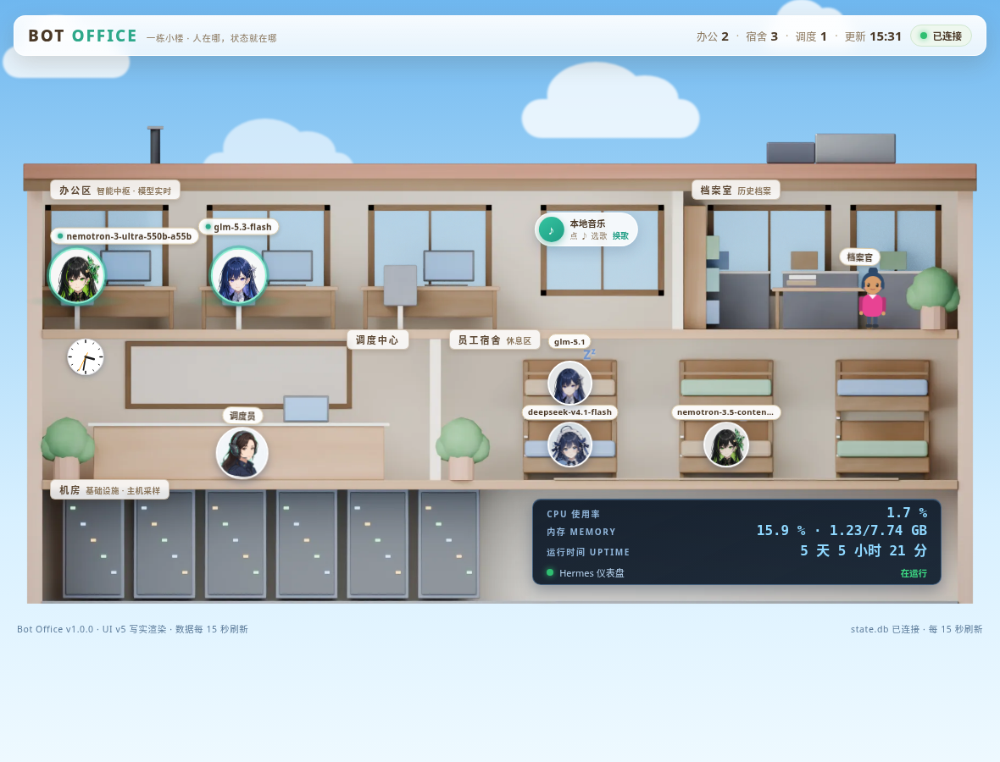
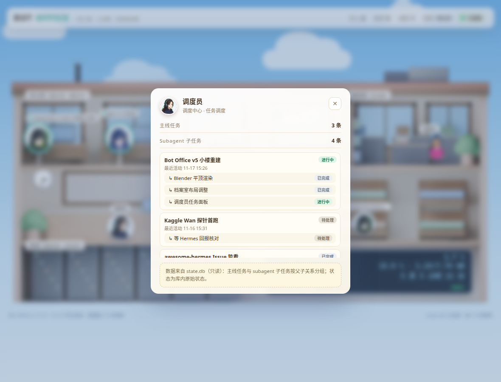
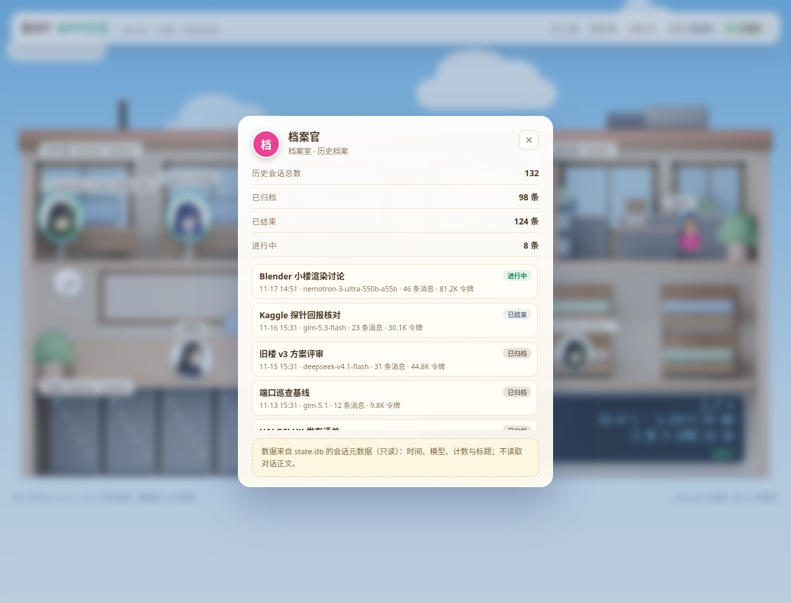

# Bot Office for Hermes

A little rendered office building for [Hermes Agent](https://github.com/NousResearch/hermes-agent) — your models live here. Groups with activity in the last 3 minutes sit at their desks working; idle groups walk back to the dorm and sleep in bunk beds. Everything is driven by Hermes's own `state.db`, opened **read-only**.



## Features

- **Live model floor** — one character per model group in `state.db`. Working models sit at desks with a halo; when they go idle they visibly *walk* to a dorm bunk and sleep (Zzz included). Built-in anime personas for the Nemotron, GLM and DeepSeek families (matched by model-name substring); any other model gets a generated chibi character.
- **Dispatcher （调度员）** — click her for the task board: main tasks and their **subagent subtasks**, grouped by the parent/child session relation, with live status badges. The data source adapts to your schema (a dedicated tasks table if one exists, otherwise the sessions parent column, otherwise a flat list — the panel always states which source it used).
- **Archivist （档案官）** — real session history from `state.db`: totals, archived count (auto-detects the archive marker column; never invents a number), and the latest 30 sessions with model, message count and tokens.
- **Server room** — host CPU / memory / uptime plus service lamps (process-name or listening-port probes), sampled on the dashboard host.
- **Office radio** — a local music player: pick an audio file from your device, it is stored in the browser (IndexedDB) and loops; the dispatcher sways along while it plays.
- **Live wall clock** — an iOS-style clock (hour, minute and orange second hand) on the dispatch-centre wall, synced to the viewer's time.
- Refreshes every 15 seconds; stops and asks for re-login on a 401.

| Dispatcher task board | Archivist history |
| --- | --- |
|  |  |

*Screenshots use fictional demo data.*

## Privacy

The backend opens `state.db` through a read-only SQLite URI (`mode=ro`). It reads **session metadata only** — model names, timestamps, counters, tool names, and session titles (titles appear only in the Archivist history and the Dispatcher board). It **never reads message content**; the `messages` table is touched only for `session_id` / `timestamp` / `tool_name` aggregates. The database path is resolved per connection from `$HERMES_DB`, else `$HERMES_HOME/state.db`, else `~/.hermes/state.db`.

## Requirements

- Hermes Agent with the web dashboard. Tested on **Hermes Agent v0.23.0 (dashboard v0.23.1)**.
- Host sampling (CPU / memory) is implemented for Linux; on other platforms the server room shows no sampling instead of fake numbers.

## Install

### Script (recommended)

```bash
git clone https://github.com/Geokkk/bot-office-for-hermes.git
cd bot-office-for-hermes
./install.sh        # Windows: .\install.ps1
```

The script copies `bot-office/` to `~/.hermes/plugins/bot-office` (backing up any previous install), then registers `bot-office` in `config.yaml` under `plugins.enabled` — with a timestamped backup of the config first. Restart the dashboard afterwards:

```bash
systemctl restart hermes-dashboard   # or however you run it
```

### Manual

1. Copy the `bot-office/` folder from this repo into `~/.hermes/plugins/`.
2. **Add `bot-office` to `plugins.enabled` in `~/.hermes/config.yaml`** — the dashboard does *not* auto-mount new plugins; without this step the tab never appears:

   ```yaml
   plugins:
     enabled:
       - bot-office
   ```
3. Restart the dashboard and open the **Bot Office** tab.

## Configuration

Everything about the roster lives in `bot-office/dashboard/office.json` — rename people, change duties, add your own static staff, or edit the service lamps there. Room kinds: `models` (live from state.db), `static` (duty posts; add `"data": "tasks"` or `"data": "archive"` to wire a person to the Dispatcher board or the Archivist history), `host` (server-room cabinets and services; a service lamp is green when its process name matches *or* its `port` is listening).

## Customization

- **Dispatcher avatar** — replace `bot-office/dashboard/dist/bot-office/avatar-dispatch.png` with any square image to give her your own face.
- **Model personas** — models whose name contains `nemotron`, `glm` or `deepseek` get the bundled full-body artwork (shown in the detail popup). To add a family, drop `persona-<key>.webp` and `avatar-<key>.png` next to the others and add an entry to the `PERSONAS` list in `dist/bot-office/index.html`.
- **Music** — the player stores one track per browser profile; your pick survives reloads and plugin updates.

## License

[PolyForm Noncommercial 1.0.0](LICENSE) — free for any noncommercial purpose; commercial use is not permitted.

---

# 中文说明

给 [Hermes Agent](https://github.com/NousResearch/hermes-agent) 的一栋写实小楼：你的模型们住在这里。近 3 分钟有活动的模型组坐在工位上干活，空闲的会自己走回宿舍、爬上上下铺睡觉。全部数据来自 Hermes 自己的 `state.db`，**只读**打开。

## 功能

- **智能中枢（实时）**：按 state.db 的模型分组，一组一人。工作中坐工位带光环，转空闲会自己走回宿舍床位睡觉（带 Zzz）。Nemotron / GLM / DeepSeek 三大家族有内置拟人形象（按模型名子串匹配），其余模型自动生成 chibi 小人。
- **调度员**：点击查看任务板 — 主线任务与 **subagent 子任务**按会话父子关系分组，带实时状态徽章。数据源按你的库结构自适应（有专用任务表读任务表，否则用 sessions 父子列，再否则平铺；面板里会如实注明用的哪一级）。
- **档案官**：state.db 的真实历史 — 会话总数、已归档条数（自动识别归档标记列，绝不编数字）、最近 30 条历史（模型、消息数、令牌数）。
- **机房**：主机 CPU / 内存 / 运行时间 + 服务灯（按进程名或监听端口探测）。
- **办公区电台**：本地音乐播放器 — 从设备里选一首歌，存浏览器 IndexedDB 循环播放，播放时调度员会跟着摇摆。
- **实时墙钟**：调度中心墙上 iOS 风格时钟（时针、分针、橙色秒针），与查看设备的时间同步。
- 每 15 秒刷新；遇到 401 停止刷新并提示重新登录。

## 隐私

后端以只读 URI（`mode=ro`）打开 `state.db`，只读**会话元数据**：模型名、时间戳、计数、工具名与会话标题（标题仅出现在档案官历史与调度员任务板中）。**从不读取对话正文**；messages 表只用于 session_id / timestamp / tool_name 的聚合。数据库路径按 `$HERMES_DB` → `$HERMES_HOME/state.db` → `~/.hermes/state.db` 顺序解析。

## 环境要求

- 带网页仪表盘的 Hermes Agent。已在 **Hermes Agent v0.23.0（dashboard v0.23.1）** 上测试。
- 主机采样（CPU / 内存）目前实现的是 Linux 版；其他平台上机房会诚实显示无采样，不编数字。

## 安装

```bash
git clone https://github.com/Geokkk/bot-office-for-hermes.git
cd bot-office-for-hermes
./install.sh        # Windows 用 .\install.ps1
```

脚本会把 `bot-office/` 复制到 `~/.hermes/plugins/bot-office`（已有安装先备份），再把 `bot-office` 登记进 `config.yaml` 的 `plugins.enabled`（改前给配置做带时间戳的备份）。装完重启仪表盘即可。

手动安装：复制 `bot-office/` 到 `~/.hermes/plugins/`，**务必把 `bot-office` 加进 `~/.hermes/config.yaml` 的 `plugins.enabled`**（仪表盘不会自动挂载新插件，漏了这一步页签永远不出现），然后重启仪表盘。

## 配置与定制

- 名单全在 `bot-office/dashboard/office.json`：改名、改职责、加人、改服务灯都在这里。
- 调度员头像：把 `dist/bot-office/avatar-dispatch.png` 换成任意方形图片即可。
- 模型形象：模型名含 `nemotron` / `glm` / `deepseek` 时用内置全身图；新增家族把 `persona-<key>.webp` 与 `avatar-<key>.png` 放进同目录，并在 `dist/bot-office/index.html` 的 `PERSONAS` 列表里加一条。

## 许可证

[PolyForm Noncommercial 1.0.0](LICENSE) — 非商业用途免费，禁止商用。
